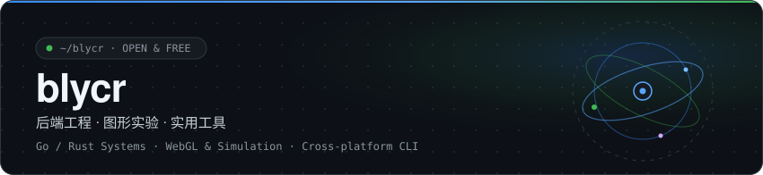
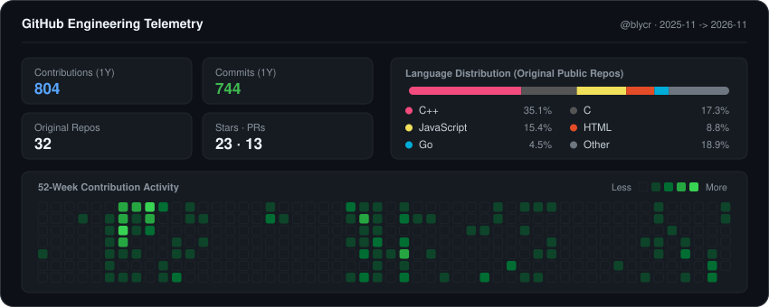

  <picture>
    <source media="(prefers-color-scheme: dark)" srcset="./assets/hero-dark.svg" />
    <source media="(prefers-color-scheme: light)" srcset="./assets/hero-light.svg" />
    
  </picture>

  
  
  
  

## 关于我

- **系统与后端工程**：偏好单二进制、低依赖、可长期演进的工程系统，主力围绕 `Go` 与 `Rust` 构建。
- **图形与物理实验**：热衷用纯前端 / `WebGL` 探索天体轨道仿真、引力透镜渲染与零构建交互体验。
- **实用主义工具链**：聚焦家庭局域网媒体服务、设备刷机修复、字幕编辑与桌面效率等真实场景。

---

## 旗舰项目 · MSP

> **[MSP (Media Share & Preview)](https://github.com/blycr/msp)** — 你的个人局域网影院（Go + Vite 单二进制媒体服务器）

- **核心特性**：零配置启动 · 优先直连播放 · 按需转码 · 断点续播 · 跨平台支持
- **相关入口**：[项目仓库](https://github.com/blycr/msp) · [Releases](https://github.com/blycr/msp/releases) · [Wiki 文档](https://github.com/blycr/msp/wiki)

  
  
  

---

## 精选项目矩阵

<table>
  <tr>
    <td width="50%" valign="top">
      <strong><a href="https://github.com/blycr/blackhole-3d">blackhole-3d</a></strong> · <code>HTML / WebGL</code> 
      单文件零依赖的 WebGL 实时黑洞可视化：史瓦西零测地线引力透镜、HDR 多级泛光、20 万开普勒粒子与 LCh 色彩循环。 
      <a href="https://blycr.github.io/blackhole-3d/">在线体验 →</a>
    </td>
    <td width="50%" valign="top">
      <strong><a href="https://github.com/blycr/3-stars">3-stars</a></strong> · <code>JavaScript / 3D</code> 
      零构建 ES-Module 3D 三体轨道模拟器，内置 13 种经典稳态预设并支持实时方程重构。 
      <a href="https://blycr.github.io/3-stars/">在线体验 →</a>
    </td>
  </tr>
  <tr>
    <td width="50%" valign="top">
      <strong><a href="https://github.com/blycr/MiWiFiRepairTool">MiWiFiRepairTool</a></strong> · <code>Rust / CLI</code> 
      小米路由器修复工具的纯命令行 Rust 重构版：支持云端固件列表或本地 <code>.bin</code> 刷入，自动拉起 DHCP / TFTP 服务。
    </td>
    <td width="50%" valign="top">
      <strong><a href="https://github.com/blycr/PlantsVsZombiesRH_tool">PlantsVsZombiesRH_tool</a></strong> · <code>C#</code> 
      植物大战僵尸融合版修改器与辅助工具（PVZ Fusion Trainer &amp; Helper Tool）。
    </td>
  </tr>
  <tr>
    <td width="50%" valign="top">
      <strong><a href="https://github.com/blycr/es">es</a></strong> · <code>JavaScript / Local-First</code> 
      本地优先的 ASS 字幕浏览器编辑器，支持元信息、样式、事件与原文编辑，以及 ZIP 打包导出。
    </td>
    <td width="50%" valign="top">
      <strong><a href="https://github.com/blycr/key-stats">key-stats</a></strong> · <code>Go / Windows</code> 
      轻量级 Windows 键盘按键统计工具，记录日常键入分布与使用频率。
    </td>
  </tr>
</table>

---

## 技术栈

| 领域 | 技术与工具 |
| :--- | :--- |
| **后端与系统** |      |
| **Web 与图形** |     |
| **框架与基础** |      |

---

## 开发数据

  <picture>
    <source media="(prefers-color-scheme: dark)" srcset="./assets/stats-dark.svg" />
    <source media="(prefers-color-scheme: light)" srcset="./assets/stats-light.svg" />
    
  </picture>

 

  <picture>
    <source media="(prefers-color-scheme: dark)" srcset="./assets/footer-dark.svg" />
    <source media="(prefers-color-scheme: light)" srcset="./assets/footer-light.svg" />
    
  </picture>

